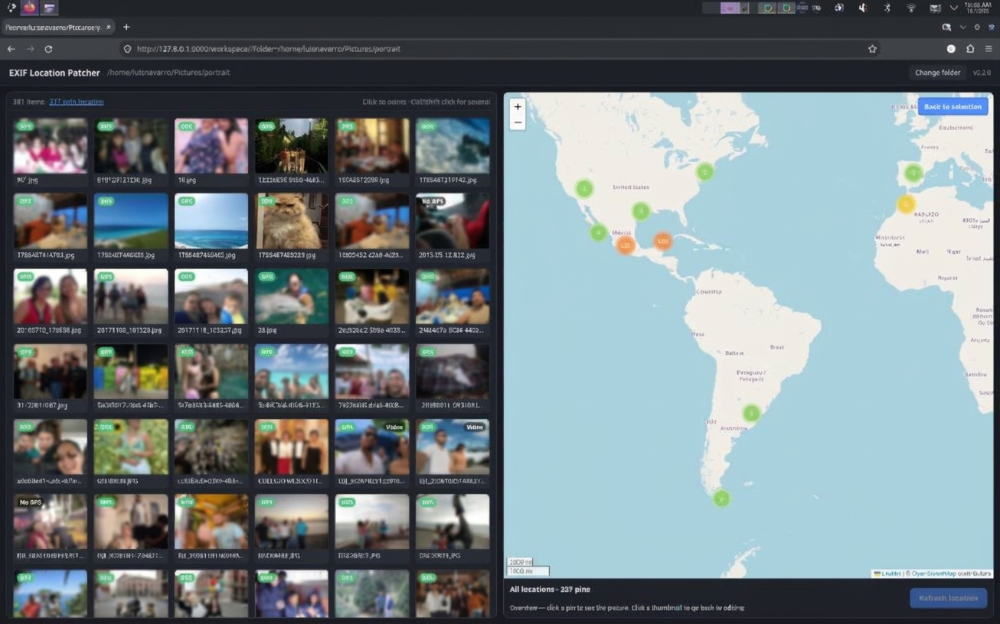

# EXIF Location Patcher

A small local Django tool to see where your pictures and videos were taken
and fix or add their GPS location.



1. **Pick a folder** on the landing page (quick links to Home, Pictures,
   Videos and mounted drives, or type a path).
2. The **workspace** shows the folder's thumbnails on the left and a map on
   the right. Click a thumbnail and the pin jumps to where it was taken.
3. Drag the pin (or click the map) to choose a new spot, then press
   **Set new location** to write it into the file. When the pin hasn't been
   moved, the button reads **Refresh location** and re-reads it from the file.

More:

- **Several files at once:** Ctrl-click or Shift-click thumbnails, then set
  one location for all of them.
- **See everything:** press **📍 Show all** in the map's corner (or click the
  "N with location" count) for a pin per located file. Close pins group
  into numbered clusters; click a pin to see the picture, then
  **Edit location** to change it. Leave with **Back to selection**, Esc, or
  any thumbnail.
- **Badges** on each thumbnail: **GPS** / **No GPS**, **Video**, and
  **Read-only** for formats the app can't write to.

> **Files are modified in place.** Make a backup of anything irreplaceable
> before patching it. See [How locations are written](#how-locations-are-written).

## Quick start

1. Install [uv](https://docs.astral.sh/uv/getting-started/installation/)
   and ffmpeg:

   | System  | uv                                                            | ffmpeg                    |
   |---------|---------------------------------------------------------------|---------------------------|
   | Linux   | `curl -LsSf https://astral.sh/uv/install.sh \| sh`            | `sudo apt install ffmpeg` |
   | macOS   | `curl -LsSf https://astral.sh/uv/install.sh \| sh`            | `brew install ffmpeg`     |
   | Windows | `powershell -c "irm https://astral.sh/uv/install.ps1 \| iex"` | `winget install ffmpeg`   |

2. Clone and run:

   ```bash
   git clone https://github.com/LuisNavarro93/exif-location-patcher.git
   cd exif-location-patcher
   uv run launcher.py          # or: uv run launcher.py 8080
   ```

   The first run downloads Python 3.12 (if needed) and the exact package
   versions in `uv.lock`. The app then opens at <http://127.0.0.1:8000/>.
   Press Ctrl+C to stop it.

**Without cloning**, run it straight from GitHub:

```bash
uvx --from git+https://github.com/LuisNavarro93/exif-location-patcher exif-location-patcher
```

**Without uv**, use plain pip (Python 3.10+):

```bash
python3 -m venv .venv
.venv/bin/pip install -r requirements.txt       # Windows: .venv\Scripts\pip install -r requirements.txt
.venv/bin/python launcher.py                    # Windows: .venv\Scripts\python launcher.py
```

**Internet access** is needed for the map: the OpenStreetMap tiles, Leaflet
and Leaflet.markercluster are loaded online. **Without ffmpeg** the app
still works, but videos show a placeholder thumbnail and can't be patched.

## Supported formats

| Format        | Read location | Write location |
|---------------|:-------------:|:--------------:|
| JPEG, WebP    | yes           | yes            |
| MP4, MOV, M4V | yes           | yes (ffmpeg)   |
| PNG, TIFF     | yes           | no (read-only) |
| 3GP           | yes           | no (read-only) |

HEIC/HEIF and camera RAW files aren't supported and don't appear in the
grid. Only files directly inside the chosen folder are shown, not
subfolders.

## How locations are written

- **Pictures:** the EXIF GPS latitude/longitude tags are replaced (via
  piexif). All other EXIF data (camera, date, orientation…) is kept.
- **Videos:** the ISO 6709 location tags used by phones
  (`com.apple.quicktime.location.ISO6709`, `location`) are set by ffmpeg,
  which copies the audio/video streams unchanged (no re-encoding).
- **Safely:** the updated file is written next to the original and then
  swapped in, so a failed write never leaves a half-written file.
- **Kept as they were:** the file's modification date and permissions. A
  read-only file you own is updated and stays read-only; a read-only file
  owned by another user is refused.
- **"No location":** files without GPS data, and photos whose GPS block is
  present but empty (some phones write zeros when they had no fix), show
  as **No GPS**.

## Settings (environment variables)

| Variable                      | What it does                         | Default                                     |
|-------------------------------|--------------------------------------|---------------------------------------------|
| `PATCHER_START_DIR`           | Folder the landing page opens at     | your home folder                            |
| `PATCHER_THUMBNAIL_CACHE_DIR` | Where generated thumbnails are kept  | `~/.cache/exif-location-patcher/thumbnails` |
| `PATCHER_THUMBNAIL_SIZE_PX`   | Longest side of thumbnails, in px    | `320`                                       |
| `DJANGO_DEBUG`                | Django debug mode                    | `true`                                      |
| `DJANGO_SECRET_KEY`           | Django secret key                    | a dev-only placeholder                      |

Example: `PATCHER_START_DIR=~/Pictures uv run launcher.py`

## Security

This is a single-user tool meant to run on your own machine. It can list
and modify any folder your user account can access, so it only listens on
`127.0.0.1`. Don't expose it on a network or put it on a server.

## Troubleshooting

| Problem | Fix |
|---|---|
| `uv: command not found` right after installing uv | Open a new terminal (the installer adds `~/.local/bin` to `PATH`). |
| Map shows grey tiles or "Access blocked" | Needs internet access. The app sends the Referer header OpenStreetMap requires; a strict privacy extension that strips it will block the tiles. |
| "No permission to write in the folder …" | Your user can't write to that folder (e.g. a read-only drive). Copy the files somewhere writable. |
| A file shows **Read-only** | Its format can't be written (see [Supported formats](#supported-formats)). |
| Videos have a grey "VIDEO" thumbnail | ffmpeg isn't installed or isn't on `PATH`. |
| First visit to a large folder is slow | Thumbnails are generated once and then cached. |
| Port 8000 is taken | Use another one: `uv run launcher.py 8080`. |

## Project layout

```
exif-location-patcher/
├── launcher.py            # starts the server and opens the browser (also the
│                          #   `exif-location-patcher` command)
├── manage.py              # Django's command-line tool
├── pyproject.toml         # dependencies and package metadata
├── uv.lock                # exact dependency versions (uv)
├── requirements.txt       # same versions, for plain pip (generated)
├── epl_config/            # Django project settings and root URLs
└── patcher/               # the app
    ├── gps.py             # read/write GPS in pictures (EXIF) and videos (ffmpeg)
    ├── services.py        # folder browsing, media listing, thumbnails
    ├── views.py           # pages and JSON endpoints
    ├── tests.py
    ├── templates/patcher/ # base, landing and workspace HTML
    └── static/patcher/    # css/ and js/
```

## Development

Run the tests:

```bash
uv run python manage.py test patcher
```

Add or change a dependency, then regenerate `requirements.txt`:

```bash
uv add <package>      # updates pyproject.toml and uv.lock
uv export --no-hashes --no-dev --no-emit-project --format requirements-txt -o requirements.txt
```

Make a release:

1. Bump `__version__` in `patcher/__init__.py` (the only place the version
   is written; `pyproject.toml` reads it from there).
2. Move the `[Unreleased]` notes in `CHANGELOG.md` under the new version
   and date.
3. Run `uv sync` and the tests, then commit and push.

The code follows a type-prefix naming convention for variables (`str_`,
`int_`, `flt_`, `bool_`, `dict_`, `lst_`, `arr_`, `obj_`, `tup_`); please
keep to it in contributions.
